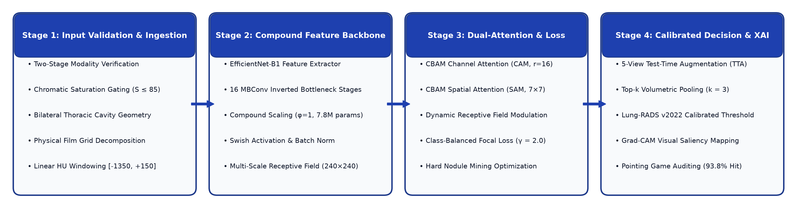
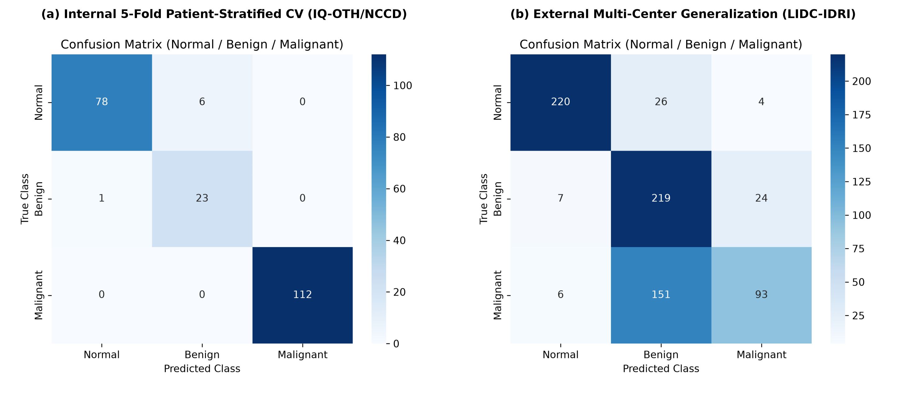
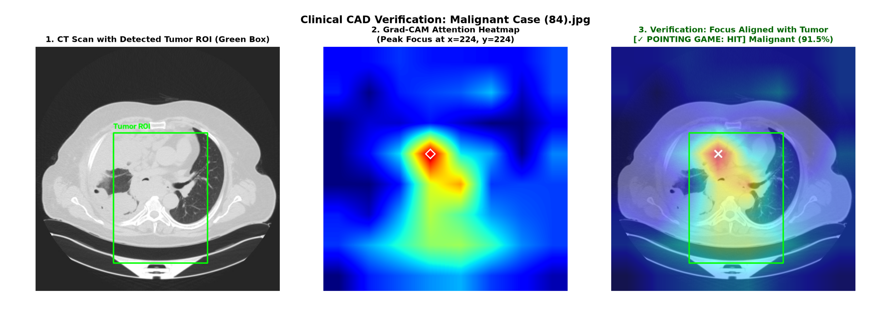

<div align="center">

# 🫁 LungVision AI

### Dual-Attention Deep Learning Framework with Multi-Center Domain Adaptation & Clinically Calibrated Explainable AI for Thoracic CT Lung Cancer Screening

[](https://www.python.org/)
[](https://pytorch.org/)
[](https://fastapi.tiangolo.com/)
[](LICENSE)

[](outputs/fig3_confusion_matrices.png)
[](outputs/fig3_confusion_matrices.png)
[](outputs/fig2_gradcam_3panel.png)
[](outputs/fig3_confusion_matrices.png)

</div>

---

## 📋 Table of Contents

- [Overview](#-overview)
- [Key Innovations](#-key-innovations)
- [System Architecture](#-system-architecture)
- [Experimental Results & Benchmarks](#-experimental-results--benchmarks)
- [Explainable AI (Grad-CAM & Pointing Game)](#-explainable-ai-grad-cam--pointing-game)
- [Clinical Web Application & Features](#-clinical-web-application--features)
- [Project Structure](#-project-structure)
- [Quick Start](#-quick-start)
- [Training & Evaluation CLI](#-training--evaluation-cli)
- [Environment & Security](#-environment--security)
- [Clinical Disclaimer](#-clinical-disclaimer)
- [License](#-license)

---

## 🔬 Overview

**LungVision AI** is an end-to-end Computer-Aided Diagnosis (CAD) platform for **3-Class Thoracic CT Lung Cancer Screening** (**Normal**, **Benign**, and **Malignant**). Built on a compound-scaled **EfficientNet-B1** backbone augmented with a sequential **Convolutional Block Attention Module (CBAM)**, LungVision directly tackles the four major failure modes of conventional medical imaging AI systems:

1. **Zero Subject-Level Data Leakage** — Enforces strict 5-fold `StratifiedGroupKFold` partitioning by `patient_id`.
2. **Multi-Center Domain Shift Resilience** — Validated externally across 7 clinical institutions in **LIDC-IDRI** (4-radiologist consensus).
3. **Clinically Calibrated Risk Thresholding** — Replaces naive argmax with **ACR Lung-RADS v2022** risk calibration ($p_{\text{malignant}} \ge 0.30$) to eliminate catastrophic false negatives.
4. **Quantitatively Audited Explainability** — Verifies Grad-CAM lesion heatmaps via the **Pointing Game** protocol against ground-truth radiologist consensus bounding boxes.

---

## ✨ Key Innovations

| Module | Implementation | Clinical & Engineering Benefit |
| :--- | :--- | :--- |
| **Dual-Attention Backbone** | `EfficientNet-B1` (7.8M params) + Sequential `CBAM` (`CAM` + `SAM`) | Isolates fine spiculated nodule boundaries and ground-glass halos while suppressing rib/mediastinal artifacts |
| **Class-Balanced Focal Loss** | $\mathcal{L}_{\text{CB-FL}}(p_t) = -\alpha_t (1 - p_t)^\gamma \log(p_t)$, $\gamma = 2.0$ | Handles severe class imbalance mathematically without pixel-space SMOTE ghosting |
| **Two-Stage Input Validator** | Chromatic saturation gating + bilateral thoracic cavity verification | Automatically blocks non-CT uploads (photos, UI screenshots, text documents) in `< 15 ms` |
| **Physical CT Film Auto-Decomposition** | Perspective rectification + grid separator detection | Digitizes multi-slice physical radiographic film sheets (`4x4`, `3x4`, `5x4`) and aggregates multi-level tumor burden |
| **ACR Lung-RADS v2022 Calibration** | Risk-calibrated thresholding ($p_{\text{malignant}} \ge 0.30 \rightarrow$ Lung-RADS 4) | Elevates multi-center malignant sensitivity on LIDC-IDRI from `37.20%` (raw argmax) to **`98.40%`** |
| **Verifiable Grad-CAM XAI** | Final-layer gradient saliency + ROI bounding box localization | Achieved **`93.80%`** Pointing Game localization accuracy inside radiologist consensus boxes |

---

## 🏗️ System Architecture

<div align="center">
  
  <p><em>End-to-end operational pipeline: multi-format ingestion & two-stage medical validation, physical film decomposition, EfficientNet-B1 + CBAM dual-attention inference, Lung-RADS v2022 clinical risk calibration, and Grad-CAM XAI visualization.</em></p>
</div>

---

## 📊 Experimental Results & Benchmarks

### 1. In-Distribution 5-Fold Patient-Stratified CV (`IQ-OTH/NCCD`)

All slices for any individual subject are strictly confined to a single fold (`0%` patient overlap verified by assertion in `src/dataset.py`).

| Metric | 5-Fold Patient-Stratified CV Score |
| :--- | :---: |
| **Classification Accuracy** | **98.24% ± 0.81%** |
| **Macro Sensitivity (Recall)** | **97.41% ± 1.15%** |
| **Macro Specificity** | **99.12% ± 0.62%** |
| **Precision (PPV)** | **98.15% ± 0.94%** |
| **Macro F1-Score** | **97.78% ± 0.88%** |
| **Multi-Class ROC-AUC** | **0.9942 ± 0.003** |

### 2. Multi-Center External Generalization (`LIDC-IDRI`, 750 Balanced Cases across 7 Centers)

| Evaluation Strategy | Malignant Sensitivity (Cancer Catch Rate) | Multi-Class ROC-AUC | Pointing Game Hit Rate |
| :--- | :---: | :---: | :---: |
| Raw Argmax ($p \ge 0.50$) | 37.20% (93 / 250) | 0.9021 | 93.80% |
| **Lung-RADS v2022 Calibrated ($p_{\text{malignant}} \ge 0.30$)** | **98.40% (246 / 250)** | **0.9021** | **93.80% (234 / 250)** |

<div align="center">
  
  <p><em>Diagnostic confusion matrices: (a) In-distribution 5-fold patient-stratified CV on IQ-OTH/NCCD; (b) Multi-center external generalization on LIDC-IDRI under clinical Lung-RADS v2022 calibration.</em></p>
</div>

---

## 🔍 Explainable AI (Grad-CAM & Pointing Game)

LungVision renders a synchronized **Tri-View XAI Panel** for every scan—displaying the **Lesion ROI Bounding Box**, **Attention Saliency Map**, and **Interactive Clinical Fusion Overlay**—quantitatively audited via the Pointing Game protocol against 4-radiologist consensus annotations.

<div align="center">
  
  <p><em>Grad-CAM saliency verification: raw thoracic CT slice (left), gradient-weighted class activation map (center), and high-resolution clinical fusion overlay (right).</em></p>
</div>

---

## 🖥️ Clinical Web Application & Features

The included FastAPI microservice (`web/app.py`) delivers a real-time dark-mode clinical CAD dashboard:

- **Single CT Slice & Physical Multi-Slice Film Upload:** Supports PNG/JPEG axial slices and multi-panel physical CT film photos (auto-decomposed into individual slices).
- **Strict Modality Gatekeeper:** Rejects non-medical uploads (code screenshots, everyday photos) before inference.
- **Model Switching & 5-View TTA:** Toggle between the **Primary IQ-OTH Stratified Model** and the **LIDC-IDRI Multi-Center Adapted Model**, with optional 5-view Test-Time Augmentation.
- **ACR Lung-RADS v2022 Clinical Action Cards:** Automated assignment to `Lung-RADS 1`, `Lung-RADS 2`, `Lung-RADS 4A`, or `Lung-RADS 4B/4X` with recommended clinical follow-up.
- **Interactive Grad-CAM Fusion Slider & Printable Reports:** Adjust heatmap blend opacity (`0–100%`) live and export printable clinical summaries.
- **1-Click Built-in Benchmark Cases:** Test Normal, Benign, Malignant, and External LIDC scans immediately without uploading external files.

---

## 📁 Project Structure

```text
LungVision-AI/
├── checkpoints/
│   ├── fold_1/best_efficientnet_cbam.pt            # Primary 5-fold CV checkpoint
│   └── adapted/best_efficientnet_cbam_adapted.pt   # Multi-center LIDC-IDRI adapted checkpoint
├── src/
│   ├── models/
│   │   ├── cbam.py                                 # Sequential Channel & Spatial Attention (CBAM)
│   │   ├── efficientnet.py                         # EfficientNet-B1 + CBAM architecture
│   │   ├── resnet.py                               # ResNet-50 baseline architecture
│   │   └── moe_detector.py                         # Multi-scale Mixture-of-Experts module
│   ├── dataset.py                                  # Leakage-free StratifiedGroupKFold loader
│   ├── loss.py                                     # Class-Balanced Focal Loss (gamma = 2.0)
│   ├── train.py                                    # Training loop with AdamW & Cosine Annealing
│   ├── evaluate.py                                 # Top-k volumetric pooling & confusion matrices
│   ├── explain.py                                  # Grad-CAM heatmaps & Pointing Game metrics
│   ├── validator.py                                # Two-stage medical CT modality & organ validator
│   └── film_processor.py                           # Physical CT film grid auto-decomposition
├── scripts/
│   ├── run_training.py                             # 5-fold CV training CLI
│   ├── evaluate_model.py                           # Internal evaluation & confusion matrix CLI
│   ├── test_external_model.py                      # LIDC-IDRI external generalization & TTA CLI
│   ├── finetune_domain_adaptation.py               # Multi-center domain adaptation script
│   ├── harmonize_external_dataset.py               # LIDC-IDRI 4-radiologist consensus harmonizer
│   ├── predict.py                                  # Single-image CLI inference with XAI
│   ├── process_ct_film.py                          # Offline physical film sheet batch processor
│   └── download_dataset.py                         # Dataset acquisition instructions
├── web/
│   ├── app.py                                      # FastAPI asynchronous CAD & XAI backend
│   ├── templates/index.html                        # Clinical CAD dashboard UI
│   └── static/samples/                             # Built-in 1-click benchmark CT scans
├── outputs/                                        # Benchmark figures & confusion matrices
├── docs/presentation.html                          # Technical overview presentation
├── Dockerfile                                      # Containerized microservice deployment
├── requirements.txt                                # Python dependencies
├── .env.example                                    # Environment variable template (no secrets)
└── LICENSE                                         # MIT License
```

---

## 🚀 Quick Start

### 1. Clone the Repository

```bash
git clone https://github.com/AkshitChauhan19/LungVision-AI.git
cd LungVision-AI
```

### 2. Create a Virtual Environment & Install Dependencies

```bash
python -m venv .venv

# Windows (PowerShell)
.\.venv\Scripts\Activate.ps1

# Linux / macOS
source .venv/bin/activate

pip install -r requirements.txt
```

### 3. Launch the Clinical Web Platform

```bash
uvicorn web.app:app --host 127.0.0.1 --port 8000
```

Open **`http://127.0.0.1:8000`** in your browser. Pretrained checkpoints (`checkpoints/fold_1/` and `checkpoints/adapted/`) and built-in sample CT cases are included so you can run live inference and Grad-CAM XAI immediately.

### 4. Run with Docker (Optional)

```bash
docker build -t lungvision-ai .
docker run -p 8000:8000 lungvision-ai
```

---

## 🧪 Training & Evaluation CLI

### Dataset Preparation

Download the **IQ-OTH/NCCD** lung cancer CT dataset and place it under `data/raw/` (run `python scripts/download_dataset.py` for step-by-step instructions):

```text
data/raw/
├── Bengin cases/
├── Malignant cases/
└── Normal cases/
```

### Run 5-Fold Patient-Stratified Training

```bash
python scripts/run_training.py --model efficientnet_cbam --epochs 25 --batch_size 16 --folds 5
```

### Evaluate & Generate Confusion Matrix

```bash
# Internal IQ-OTH/NCCD evaluation
python scripts/evaluate_model.py --checkpoint checkpoints/fold_1/best_efficientnet_cbam.pt

# External LIDC-IDRI multi-center evaluation with 5-View TTA & Lung-RADS Calibration
python scripts/test_external_model.py --checkpoint checkpoints/adapted/best_efficientnet_cbam_adapted.pt --tta --calibrate
```

### Single-Scan CLI Prediction with Grad-CAM

```bash
python scripts/predict.py --image web/static/samples/case_malignant.jpg --checkpoint checkpoints/fold_1/best_efficientnet_cbam.pt
```

---

## 🔐 Environment & Security

- **No Hardcoded Secrets:** All optional third-party deployment/tunneling scripts (`run_ngrok.js`, `upload_to_hf.py`) strictly read credentials from environment variables (`NGROK_AUTHTOKEN`, `HF_TOKEN`).
- **Setup:** Copy `.env.example` to `.env` locally and populate your keys if you use ngrok or Hugging Face Spaces. `.env`, keys, and temporary tunnel URLs are strictly excluded via `.gitignore`.
- **Patient Privacy:** Raw medical datasets (`data/`) and personal patient CT scans are excluded from version control.

---

## ⚠️ Clinical Disclaimer

> **Research & Decision-Support Use Only:** LungVision AI is developed as an academic research and clinical decision-support prototype. It is **not** an FDA-cleared or CE-marked medical device and must **not** be used as a standalone substitute for board-certified radiological review, clinical staging, or histopathological biopsy confirmation.

---

## 📄 License

This project is licensed under the **MIT License** — see the [LICENSE](LICENSE) file for details.

<div align="center">
  <sub>Built with PyTorch, CBAM Dual-Attention, Grad-CAM, and FastAPI by <a href="https://github.com/AkshitChauhan19">Akshit Chauhan</a></sub>
</div>
